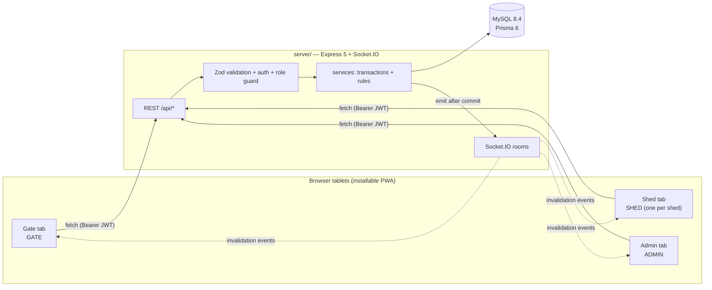

# 01 — Architecture

Three tablets, one API, one database. Every screen talks to the same Express
API; the API owns every rule; MySQL is the only source of truth. Socket.IO
carries hints, never data.

## Shape



Text equivalent:

```text
[Gate]  ─┐
[Shed]  ─┼─ REST writes/reads + WebSocket hints ─ Express ─ Prisma ─ MySQL 8.4
[Admin] ─┘
```

- REST for everything that reads or changes state.
- Socket.IO for "something changed, refetch" only. Payloads carry IDs and
  timestamps, not balances or records.
- No caching layer, no queue, no second service. One API process, one database.

## Request → transaction → push

The confirm step is the whole system in miniature
(`server/src/modules/visits/visits.service.ts`):

1. **Request.** `POST /api/requirement-lines/:id/confirm` with
   `{ loadedQty }`. The route runs the API rate limiter, the `auth` middleware
   (JWT → `req.user`, user row re-read, `403 ACCOUNT_DISABLED` if the account is
   disabled), `requireRole("SHED", "ADMIN")`, and Zod validation of the body.
2. **Rules before anything moves.** The line must belong to the caller's shed
   (unless `ADMIN`), must still be `PENDING`, and `loadedQty` must be between 1
   and `requestedQty`. A second confirm of the same line is a 409 with no state
   change.
3. **One interactive Prisma transaction**, locking in a fixed order —
   visit, then requirement line, then item — so two confirms cannot interleave:
   - reject the line if the visit is `CHECKED_OUT` or `CANCELLED`;
   - reject the line if it is not `PENDING` or not the caller's shed;
   - decrement `Item.currentStock` by `loadedQty` and compute `balanceAfter`
     under the lock;
   - set the line `LOADED` with `loadedQty`, `confirmedByUserId`, `confirmedAt`;
   - insert exactly one `StockLedger` row (`type OUT`, negative `delta`,
     `balanceAfter`, `requirementLineId`, actor, visit);
   - recalculate the visit status from its line statuses
     (`AWAITING_LOADING` / `PARTIALLY_LOADED` / `READY_FOR_CHECKOUT` /
     `CANCELLED`, in `server/src/utils/visitStatus.ts`);
   - write an `AuditEvent` row.
4. **Commit.** If anything throws, the whole thing rolls back — stock, line,
   ledger and audit move together or not at all. Stock-mutating transactions
   (confirm, checkout) are retried once on a MySQL deadlock (`P2034`,
   `withDeadlockRetry`).
5. **Push after commit.** Only then does the service emit to the relevant rooms:
   `loading.confirmed`, `visit.statusChanged`, `stock.updated`,
   `inventory.changed`. A socket failure is swallowed; inventory is never rolled
   back because a notification failed.
6. **Client reacts.** `client/src/providers/socket-provider.tsx` is the single
   owner of socket listeners: it invalidates the TanStack Query cache on every
   event, so gate, shed and admin screens refetch and the tablets catch up
   without a manual refresh. On socket reconnect the client refetches everything.

The same pattern (validate → transaction → single ledger row → emit) holds for
visit creation, line/visit cancellation, checkout, item creation, stock-in and
stock adjustment. Admin user management follows the same transaction-plus-audit
shape but emits no socket event.

## Backend module map

Structure is route → controller → service → Prisma, one folder per module, with
Zod schemas in `server/src/validators/` and shared helpers in
`server/src/utils/`. `server/src/app.ts` wires middleware in this order: helmet,
CORS allowlist, 100 kB JSON/urlencoded limits, `/api` rate limiter, `/health`,
then module routes, then 404 and the central error handler.

| Module | Files (`server/src/modules/…`) | Endpoints | Roles |
| --- | --- | --- | --- |
| auth | `auth/auth.routes.ts`, `.controller.ts`, `.service.ts` | `POST /api/auth/login` (login rate limiter), `GET /api/auth/me` | login is public; `me` authenticated |
| users | `users/users.routes.ts`, `.controller.ts`, `.service.ts` | `GET /api/users`, `POST /api/users`, `PATCH /api/users/:id`, `POST /api/users/:id/reset-password` | `ADMIN` only (router-level `auth` + `requireRole("ADMIN")`) |
| visits | `visits/visits.routes.ts`, `.controller.ts`, `.service.ts`, `.dto.ts` | `POST /api/visits`, `GET /api/visits`, `POST /api/visits/:id/cancel`, `POST /api/visits/:id/checkout` | `GATE`, `ADMIN` |
| requirement lines | same module, second router | `POST /api/requirement-lines/:id/cancel`, `POST /api/requirement-lines/:id/confirm` | cancel `GATE`/`ADMIN`; confirm `SHED`/`ADMIN` |
| sheds | `sheds/sheds.routes.ts`, `.controller.ts`, `.service.ts` | `GET /api/sheds`, `GET /api/sheds/:code/queue` | list all authenticated; queue `SHED` (own code), `ADMIN` |
| items | `items/items.routes.ts`, `.controller.ts`, `.service.ts` | `GET /api/items`, `POST /api/items`, `PUT /api/items/:id`, `DELETE /api/items/:id` (archive), `POST /api/items/:id/stock-in`, `POST /api/items/:id/adjust` | list all authenticated; the rest `ADMIN` |
| logs | `logs/logs.routes.ts`, `.controller.ts`, `.service.ts` | `GET /api/logs` (filters + pagination), `GET /api/logs/export` (CSV), `GET /api/logs/export.xlsx` (Excel) | `ADMIN` |
| dashboard | `dashboard/dashboard.routes.ts`, `.controller.ts`, `.service.ts` | `GET /api/dashboard` | `ADMIN`, `GATE`, `SHED` |

Shed scoping is enforced inside the services, not in the routers: `listItems`,
`getDashboard`, `getShedQueue` and `confirmLine` all compare the verified
`req.user.shedId` with the row's shed and fail closed (`403 CROSS_SHED`) when a
`SHED` account has no shed or asks for another shed.

Cross-cutting pieces:

- `config/env.ts` — required env vars and the production startup gate
  (`assertProductionEnv()` called from `index.ts`).
- `config/socket.ts` — Socket.IO attach, handshake auth, room joins, the
  `session.expired` timer, and the emit helpers (`roomsForSheds`, `emitToRooms`).
- `middlewares/` — `auth`, `requireRole`, `validate` / `validateQuery`,
  `limiters` (login and API), `errorHandler` (single `{ error }` shape).
- `utils/` — `jwt`, `password`, `csv`, `rowLocks`, `visitStatus`, `retry`
  (deadlock retry), `audit`, `responses`, `errors`, `datetime`. Excel export is
  built directly with ExcelJS in `logs/logs.service.ts`.
- `prisma/schema.prisma` — Shed, User, Item, Visit, RequirementLine,
  StockLedger, AuditEvent. Stock is `Item.currentStock`, and every change writes
  a ledger row, so `Σ StockLedger.delta = Item.currentStock` must always hold.
- `prisma/migrations/` — one squashed init migration containing the full schema,
  `users.isActive`, and `stock_ledger.reason VARCHAR(255)`.
- `prisma/seed.ts` — 2 sheds (`SHED-A`, `SHED-B`), 10 items with opening ledger
  rows, 4 users (`admin`, `gate`, `sheda`, `shedb`); `--reset` wipes first.

User management is built: the `users` module creates and updates accounts
(name, username, role, shed, `isActive`) and resets passwords, with
`USER_CREATED` / `USER_UPDATED` / `USER_DISABLED` / `USER_ENABLED` /
`USER_PASSWORD_RESET` audit rows. `passwordHash` is never selected into a
response. A disabled account gets the generic `401 INVALID_CREDENTIALS` at login
and `403 ACCOUNT_DISABLED` from the auth middleware on any authenticated call.

All responses use `{ data }` or `{ error: { code, message } }`.

## Roles and rooms

Socket rooms are assigned by the server from the verified identity; the client
cannot pick its own room.

| Role | Room | Joined when |
| --- | --- | --- |
| `SHED` | `shed:{code}` (e.g. `shed:SHED-A`) | handshake, using the shed code from the database |
| `GATE` | `gate` | handshake |
| `ADMIN` | `admin` | handshake |

Events emitted by the current code:

| Event | Fired on | Rooms |
| --- | --- | --- |
| `requirement.created` | visit registered | each involved `shed:{code}`, `gate`, `admin` |
| `visit.statusChanged` | register, cancel, confirm, checkout | involved sheds, `gate`, `admin` |
| `loading.confirmed` | line confirmed | involved sheds, `gate`, `admin` |
| `stock.updated`, `inventory.changed` | confirm, item create/update, stock-in, adjust | item's shed, `gate`, `admin` |
| `session.expired` | the per-socket token expiry timer fires | that one socket (`socket.emit`), not a room |

`session.expired` closes the client session deliberately. The server emits it and
then disconnects the socket; the client (`client/src/providers/socket-provider.tsx`)
removes its listeners, disconnects, calls `logout()` — which clears the TanStack
Query cache — and shows "Session expired. Sign in again." There is no
reconnect attempt with the dead token, so no stale data or stale socket survives
an expired session.

## Auth and session model

- **Login.** `POST /api/auth/login` checks a bcrypt hash (12 rounds) and returns
  a JWT. Bad username, bad password and a disabled account all give the same
  generic error.
- **Token.** HS256, access only, ~8 h (one shift), payload `userId`, `role`,
  `shedCode`. There is no refresh token and no revocation list: logout is
  client-side.
- **Per-request check.** `auth` re-reads the user row on every request and
  attaches `req.user`; a missing row is `401 UNAUTHORIZED`, a disabled account is
  `403 ACCOUNT_DISABLED`.
- **Client storage.** The token lives in React memory (auth context) and is sent
  as a `Bearer` header by `client/src/lib/api-client.ts`. It is never written to
  `localStorage` or a cookie, and no API or auth response is cached by the
  service worker. Consequence, by design: a cold launch of the installed app is
  logged out and needs a fresh login.
- **Authorisation.** `requireRole(...)` gates the route; the `users` router
  requires `ADMIN` for every endpoint. Shed scoping is a server-side rule — a
  shed user only reaches their own shed's queue, lines, items and dashboard.
  `RoleGuard` in the client only decides which screen to show.
- **Socket auth.** The socket handshake reads `socket.handshake.auth.token`,
  verifies it with the same secret, loads the user and joins rooms from the
  database record. Invalid or missing tokens are rejected; a timer emits
  `session.expired` and disconnects the socket when the token expires.
- **Transports.** HTTPS is required in a real deployment (PWA installation and
  any future cookie work). CORS is an exact-origin allowlist from `CORS_ORIGIN`,
  shared by Express and Socket.IO.

## Accepted risks

These are deliberate POC trade-offs, not oversights. They are fine for a
single-depot demo and must be revisited before production use.

| # | Accepted risk | Why it is acceptable now | What breaks if ignored later |
| --- | --- | --- | --- |
| 1 | **Single API instance.** No clustering, no sticky sessions. | Demo load is three tablets. | Adding a second instance splits Socket.IO rooms; clients on the other instance get no alerts. Fix = Redis adapter or sticky sessions. |
| 2 | **No Redis, no transactional outbox.** Push happens after commit, in-process. | One process, one commit path; the next refetch repairs any missed hint. | A crash between commit and emit loses the notification until reconnect/focus refetch; an event is never replayed automatically. |
| 3 | **Token in memory only.** Cold launch = logged out. | No token to steal from disk; tablets are shared and watched. | Users must log in after every cold start; no "remember me". |
| 4 | **No refresh token, no revocation list.** 8 h access token. | One shift, small trusted user set. REST calls stop working the moment an account is disabled, because the user row is re-read per request. | A leaked token is rejected only at expiry for the socket path; there is no way to kill a token out of band beyond disabling the account. |
| 5 | **In-memory rate limiting.** | Cheap, no infrastructure. | Limits reset on restart and are per-process; a restart clears the counters. |
| 6 | **No offline mutations or queue.** Offline = read-only with stale labels. | Prevents invented stock numbers and duplicate loads on a flaky network. | Depot staff cannot work through an outage; they must retry when the connection returns. |
| 7 | **Socket-only live updates, no polling.** | One mechanism, simple to reason about. | If the socket dies the screens fall back to focus/reconnect refetch; there is no timed poll. |
| 8 | **No last-admin guard.** Only self-disable is blocked. | One depot officer account in the demo, managed by hand. | Two admins can disable each other and leave no `ADMIN` login; recovery is a seed/manual DB fix. |

Current implementation gaps against this design, and the items that are still
unverified (no Docker build, no deployment, no CI, no device test, no 3–5 vehicle
demo run), are listed with severity on **`docs/project-status.md`**. That page,
plus `docs/decisions_made.md`, is authoritative for "how it behaves today"; this
page describes the intended shape.
