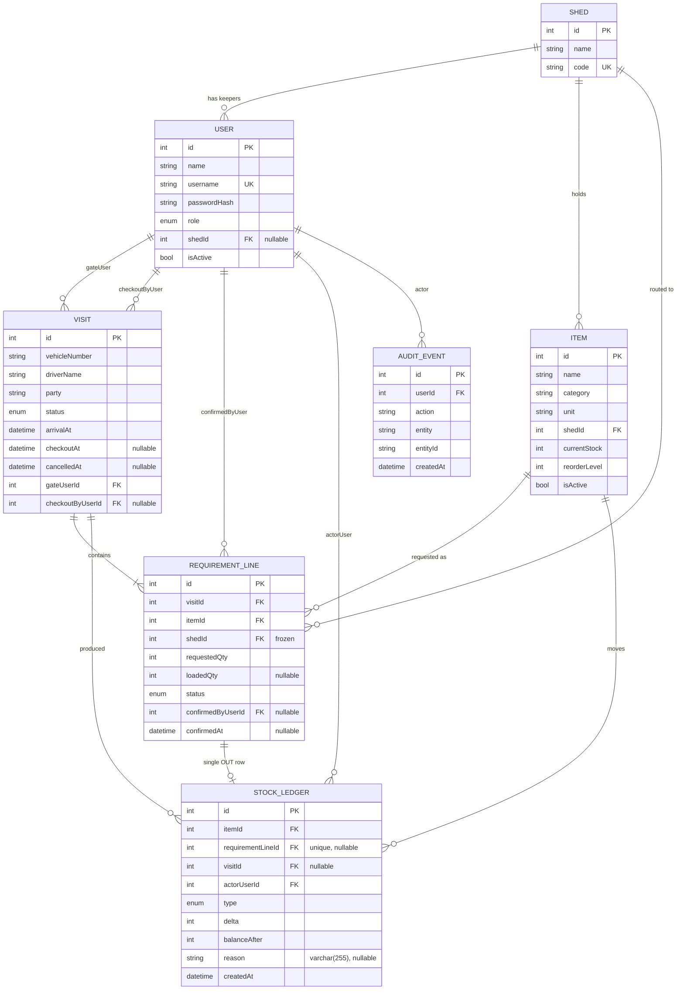

# Data Model

Source of truth for the schema: `server/prisma/schema.prisma` and the single
squashed init migration in `server/prisma/migrations/`:

| Migration | What it does |
|---|---|
| `20261029110447_init` | all seven tables, enums, indexes and foreign keys, `users.isActive BOOLEAN NOT NULL DEFAULT true`, and `stock_ledger.reason VARCHAR(255)` |

`prisma migrate status` reports the migration applied and the schema in sync. New
schema changes must be new migrations, not edits to `init`. Target
product behaviour: `docs/decisions_made.md` and `docs/project-status.md`.

Database: MySQL 8.4 via Prisma 6. All tables use `utf8mb4` / `utf8mb4_unicode_ci`.
Every primary key is an auto-increment `INT`. There are no soft-delete columns
(`deletedAt`) anywhere; `User` and `Item` use an `isActive` flag.

## 1. Enums

These four are the authoritative status vocabularies. Old concept names
(Registered, Partly loaded, Loaded) are superseded.

| Enum | Values | Used by |
|---|---|---|
| `Role` | `ADMIN`, `GATE`, `SHED` | `users.role` |
| `VisitStatus` | `AWAITING_LOADING`, `PARTIALLY_LOADED`, `READY_FOR_CHECKOUT`, `CHECKED_OUT`, `CANCELLED` | `visits.status` |
| `RequirementLineStatus` | `PENDING`, `LOADED`, `CANCELLED` | `requirement_lines.status` |
| `LedgerType` | `OPENING`, `IN`, `OUT`, `ADJUST` | `stock_ledger.type` |

Allowed transitions:

```
Visit:  AWAITING_LOADING -> PARTIALLY_LOADED -> READY_FOR_CHECKOUT -> CHECKED_OUT
        any state before CHECKED_OUT -> CANCELLED (cancel rules apply)

Line:   PENDING -> LOADED
        PENDING -> CANCELLED
        (LOADED and CANCELLED are terminal)
```

Visit status is never set by hand on confirm/cancel; it is recomputed from the
line statuses by `recalcVisitStatus` (`server/src/utils/visitStatus.ts`):

- all lines `CANCELLED` (and at least one line) → `CANCELLED`
- no `PENDING` and at least one `LOADED` → `READY_FOR_CHECKOUT`
- at least one `LOADED` and at least one `PENDING` → `PARTIALLY_LOADED`
- otherwise → `AWAITING_LOADING`

`CHECKED_OUT` is the only status written directly, by the checkout endpoint,
and only from `READY_FOR_CHECKOUT` (guarded by a conditional `updateMany`).

## 2. Entities

### 2.1 `Shed` (`sheds`)

| Field | Type | Null | Default | Notes |
|---|---|---|---|---|
| `id` | int | no | autoincrement | PK |
| `name` | varchar(191) | no | — | display name, e.g. `Shed A` |
| `code` | varchar(191) | no | — | **unique**; used in API paths and socket rooms (`SHED-A`) |

Relations: `users[]`, `items[]`, `requirementLines[]`.
Indexes/uniques: `sheds_code_key (code)`. No timestamps.

### 2.2 `User` (`users`)

| Field | Type | Null | Default | Notes |
|---|---|---|---|---|
| `id` | int | no | autoincrement | PK |
| `name` | varchar(191) | no | — | display name |
| `username` | varchar(191) | no | — | **unique**, lowercase in seed (`admin`, `gate`, `sheda`, `shedb`) |
| `passwordHash` | varchar(191) | no | — | bcrypt, 12 rounds; never returned by any endpoint |
| `role` | enum `Role` | no | — | |
| `shedId` | int | **yes** | null | FK → `sheds.id`, `ON DELETE SET NULL`; set only for `SHED` users |
| `isActive` | boolean | no | `true` | `false` = disabled login. Added in `init` |

Relations: `shed?`, `gateVisits[]` (`GateUser`), `checkoutVisits[]` (`CheckoutUser`),
`confirmedLines[]`, `ledgerEntries[]`, `auditEvents[]`.
Indexes/uniques: `users_username_key (username)`.

There are no `createdAt` / `updatedAt` columns on users — see §10.

`isActive` enforcement today:

- login returns the generic `401 INVALID_CREDENTIALS` (no hint that the account
  exists but is disabled);
- the `auth` middleware re-reads the row per request and returns
  `403 ACCOUNT_DISABLED` for a disabled account, so an existing token stops
  working on every REST route;
- disabling your own account is refused (`409 CANNOT_DISABLE_SELF`). There is no
  guard against disabling the last active admin.

### 2.3 `Item` (`items`)

| Field | Type | Null | Default | Notes |
|---|---|---|---|---|
| `id` | int | no | autoincrement | PK |
| `name` | varchar(191) | no | — | |
| `category` | varchar(191) | no | — | |
| `unit` | varchar(191) | no | — | `box`, `pcs`, `kg` in seed |
| `shedId` | int | no | — | FK → `sheds.id`, `ON DELETE RESTRICT`; the shed that holds the item |
| `currentStock` | int | no | `0` | denormalised roll-up of the ledger, see §6 |
| `reorderLevel` | int | no | `0` | drives dashboard low-stock list |
| `isActive` | boolean | no | `true` | `false` = archived (§7) |

Relations: `shed`, `requirementLines[]`, `ledgerEntries[]`.
Indexes/uniques: `items_shedId_idx (shedId)`. No unique on `(shedId, name)`, so
duplicate names inside one shed are possible at DB level.

Unit and shed are fixed at creation: `updateItemSchema`
(`server/src/validators/item.schemas.ts`) only accepts `name`, `category`,
`reorderLevel`, `isActive`. Stock is never edited through the item update — only
stock-in, adjust and line confirmation move it. Name, category and reorder level
are editable at any time, including after stock history; there is no
"item has history" guard.

### 2.4 `Visit` (`visits`)

| Field | Type | Null | Default | Notes |
|---|---|---|---|---|
| `id` | int | no | autoincrement | PK |
| `vehicleNumber` | varchar(191) | no | — | registration input, max 20 chars |
| `driverName` | varchar(191) | no | — | max 120 |
| `party` | varchar(191) | no | — | consignor/consignee party, max 120 |
| `status` | enum `VisitStatus` | no | `AWAITING_LOADING` | |
| `arrivalAt` | datetime(3) | no | `now()` | set by gate at registration; also the log date field |
| `checkoutAt` | datetime(3) | yes | null | set once at checkout |
| `cancelledAt` | datetime(3) | yes | null | set on visit/line cancel when the visit becomes `CANCELLED`, cleared otherwise |
| `gateUserId` | int | no | — | FK → `users.id`, `ON DELETE RESTRICT` |
| `checkoutByUserId` | int | yes | null | FK → `users.id`, `ON DELETE SET NULL` |

Relations: `gateUser`, `checkoutByUser`, `requirementLines[]`, `ledgerEntries[]`.
Indexes/uniques: `visits_status_idx (status)`.

### 2.5 `RequirementLine` (`requirement_lines`)

| Field | Type | Null | Default | Notes |
|---|---|---|---|---|
| `id` | int | no | autoincrement | PK |
| `visitId` | int | no | — | FK → `visits.id`, `ON DELETE RESTRICT` |
| `itemId` | int | no | — | FK → `items.id`, `ON DELETE RESTRICT` |
| `shedId` | int | no | — | FK → `sheds.id`, `ON DELETE RESTRICT`; **frozen copy** of the item's shed (§5) |
| `requestedQty` | int | no | — | 1..1,000,000 |
| `loadedQty` | int | yes | null | set on confirm, 1..`requestedQty` |
| `status` | enum `RequirementLineStatus` | no | `PENDING` | |
| `confirmedByUserId` | int | yes | null | FK → `users.id`, `ON DELETE SET NULL` |
| `confirmedAt` | datetime(3) | yes | null | |
| `ledgerEntry` | relation | — | — | 1:1 back-reference to `StockLedger.requirementLineId` |

Indexes/uniques:

- `requirement_lines_visitId_itemId_key` — **unique `(visitId, itemId)`**: one line per item per visit, so a vehicle cannot request the same item twice.
- `requirement_lines_visitId_shedId_status_idx` — `(visitId, shedId, status)`: serves the shed queue (`shedId + status = PENDING`) and per-visit status recomputation.

### 2.6 `StockLedger` (`stock_ledger`)

| Field | Type | Null | Default | Notes |
|---|---|---|---|---|
| `id` | int | no | autoincrement | PK |
| `itemId` | int | no | — | FK → `items.id`, `ON DELETE RESTRICT` |
| `requirementLineId` | int | yes | null | FK → `requirement_lines.id`, `ON DELETE SET NULL`; **unique** |
| `visitId` | int | yes | null | FK → `visits.id`, `ON DELETE SET NULL` |
| `actorUserId` | int | no | — | FK → `users.id`, `ON DELETE RESTRICT` |
| `type` | enum `LedgerType` | no | — | `OPENING` / `IN` / `OUT` / `ADJUST` |
| `delta` | int | no | — | signed: `+` increases stock, `-` decreases |
| `balanceAfter` | int | no | — | item stock immediately after this row (audit snapshot) |
| `reason` | **varchar(255)** | yes | null | `@db.VarChar(255)`; free text, defaults `Opening stock`, `Stock in`; required for `ADJUST`, max 255 to match `adjustStockSchema` |
| `createdAt` | datetime(3) | no | `now()` | |

Indexes/uniques: `stock_ledger_requirementLineId_key (requirementLineId)`,
`stock_ledger_itemId_createdAt_idx (itemId, createdAt)`.

The unique `requirementLineId` is the DB-level guard against double-confirming a
line: a second `OUT` row for the same line cannot be written.

There is deliberately **no `updatedAt`** — see §6.

### 2.7 `AuditEvent` (`audit_events`)

| Field | Type | Null | Default | Notes |
|---|---|---|---|---|
| `id` | int | no | autoincrement | PK |
| `userId` | int | no | — | FK → `users.id`, `ON DELETE RESTRICT` |
| `action` | varchar(191) | no | — | see list below |
| `entity` | varchar(191) | no | — | `Item`, `Visit`, `RequirementLine`, `User` |
| `entityId` | varchar(191) | no | — | stored as string |
| `createdAt` | datetime(3) | no | `now()` | |

No indexes beyond the PK. Actions written today (`server/src/utils/audit.ts`
callers): `ITEM_CREATED`, `ITEM_UPDATED`, `ITEM_ARCHIVED`, `ITEM_DELETED`,
`STOCK_IN`, `STOCK_ADJUSTED`, `VISIT_CREATED`, `VISIT_CANCELLED`,
`LINE_CANCELLED`, `LINE_CONFIRMED`, `VISIT_CHECKOUT`, `USER_CREATED`,
`USER_UPDATED`, `USER_DISABLED`, `USER_ENABLED`, `USER_PASSWORD_RESET`. Audit rows
are written inside the same transaction as the change they record.

## 3. ER diagram



## 4. Foreign-key delete behaviour

| Child column | Reference | On delete |
|---|---|---|
| `users.shedId` | `sheds.id` | `SET NULL` |
| `items.shedId` | `sheds.id` | `RESTRICT` |
| `visits.gateUserId` | `users.id` | `RESTRICT` |
| `visits.checkoutByUserId` | `users.id` | `SET NULL` |
| `requirement_lines.visitId` / `itemId` / `shedId` | `visits` / `items` / `sheds` | `RESTRICT` |
| `requirement_lines.confirmedByUserId` | `users.id` | `SET NULL` |
| `stock_ledger.itemId` / `actorUserId` | `items` / `users` | `RESTRICT` |
| `stock_ledger.requirementLineId` / `visitId` | `requirement_lines` / `visits` | `SET NULL` |
| `audit_events.userId` | `users.id` | `RESTRICT` |

Consequence: an item with any history cannot be hard-deleted (the FK refuses
it), and a user who has handled stock or a visit cannot be deleted at all — which
is why items are archived (§7) and users are disabled (`isActive = false`), not
deleted. There is no user delete endpoint.

## 5. Frozen `shedId` on requirement lines

`RequirementLine.shedId` is copied from `Item.shedId` when the line is created
(`createVisit`) and is **never updated afterwards**. Line updates only touch
`status`, `loadedQty`, `confirmedByUserId`, `confirmedAt`.

Why it matters:

- Routing is decided at registration time. Moving an item to another shed later
  does not re-route, re-queue or re-alert lines that already exist.
- The shed queue (`GET /api/sheds/:code/queue`) and shed permissions
  (`CROSS_SHED` on confirm) read this frozen column, not the item's current shed.
- Shed scoping checks compare `line.shedId` with `user.shedId`; the user's shed is
  read live from `users`.

## 6. Stock ledger invariant and append-only rule

**Invariant (must hold for every item at all times):**

```
items.currentStock = SUM(stock_ledger.delta)  WHERE stock_ledger.itemId = items.id
```

`balanceAfter` is a denormalised snapshot for auditing and is not the source of
truth; if it ever disagrees with the running sum, the sum of `delta` wins.

**Write path (single transaction, item row locked):**

1. `SELECT ... FROM items WHERE id = ? FOR UPDATE` (`lockItemForUpdate`).
2. Compute `balanceAfter = currentStock + delta`.
3. Update `items.currentStock = balanceAfter`.
4. Insert exactly one `stock_ledger` row with the same `delta` and `balanceAfter`.
5. Write the audit event.

Who writes which row:

| Action | Ledger `type` | `delta` | Extra columns |
|---|---|---|---|
| Item created with opening stock (`POST /api/items`) and seed | `OPENING` | `+currentStock` (0 allowed) | `reason = 'Opening stock'` |
| Stock-in (`POST /api/items/:id/stock-in`) | `IN` | `+qty` | `reason` from body or `'Stock in'` |
| Manual adjust (`POST /api/items/:id/adjust`) | `ADJUST` | `qty` (signed, never 0) | `reason` required, max 255; result may not go below 0 |
| Line confirm (`POST /api/requirement-lines/:id/confirm`) | `OUT` | `-loadedQty` | `requirementLineId`, `visitId`; `reason` null |

`OUT` is the only write that may take `currentStock` below zero: confirm is
warn-only, so recorded stock can go negative when a shed loads more than the
system believed was on hand. `ADJUST` refuses a zero delta and refuses any
adjustment that would end below zero (`409 NEGATIVE_STOCK`), so a negative
balance can only be created by confirming a line — there is no way to "adjust it
back" through a negative-going correction; you stock in first.

Every item gets an `OPENING` row at creation, even when opening stock is `0`.

**Append-only rule:** ledger rows are inserted once and never updated or deleted
by application code. There is no UPDATE/DELETE path in `items.service.ts` or
`visits.service.ts`. Corrections are made by posting a compensating `ADJUST` row,
not by editing history. There is no DB trigger enforcing this — it is a code
convention, reinforced by the unique `requirementLineId` (one `OUT` row per line).

## 7. Archive and soft-delete rules

Applies to `Item` only. `User` has `isActive` for account disabling (not archive),
and `Shed`, `Visit`, `RequirementLine` and `StockLedger` have no flag at all.

| Situation | Behaviour |
|---|---|
| `DELETE /api/items/:id` on an item with **any** requirement line or ledger row | sets `isActive = false`, writes `ITEM_ARCHIVED`, responds `{ archived: true, item }` |
| `DELETE /api/items/:id` on an item with no lines and no ledger rows | hard deletes the row, writes `ITEM_DELETED`, responds `{ archived: false, item }` |
| `PUT /api/items/:id` with `isActive: false` | archives; other fields in the same request are still written |
| `PUT /api/items/:id` with `isActive: true` | restores the item; the admin inventory screen shows archived rows and offers restore |

Read rules:

- `GET /api/items` returns only `isActive = true` unless `includeInactive=true`
  (or `1`) is sent. `includeInactive` accepts `true`/`false`/`1`/`0` explicitly;
  any other value is `400 VALIDATION_ERROR`.
- The admin inventory screen sends `includeInactive=true` and marks archived rows,
  so archived items are visible and restorable from the UI.
- Archived items stay attached to existing visits, lines and ledger rows: they are
  filtered out of active lists, never out of history. Logs still show their name.
- There is no separate restore endpoint; restore is `PUT` with `isActive: true`.
- Archived items are rejected for new work (`POST /api/visits` → `409 ITEM_INACTIVE`)
  and for stock movements (`stock-in` / `adjust` → `409 ITEM_INACTIVE`), but a
  pending line for an item archived after the visit was registered can still be
  confirmed — confirm does not check `isActive`, so a live visit can never be
  stranded.

## 8. User and shed model

- One `Shed` per physical store; `code` is the stable identifier used in URLs,
  socket rooms and exports (`SHED-A`, `SHED-B`).
- `User.role` decides scope: `ADMIN` is depot-wide (`shedId` null), `GATE` is
  depot-wide (`shedId` null), `SHED` is bound to exactly one shed.
- The rule "role `SHED` must have a shed, other roles must not" is enforced in the
  users service (`SHED_REQUIRED`, `SHED_NOT_ALLOWED`), not by the database: the
  column is nullable and there is no DB check constraint.
- Shed scoping is fail-closed in the services: a `SHED` user with `shedId = null`
  gets `403 CROSS_SHED` on the item list, dashboard, shed queue and line confirm.
- `shedCode` is not stored on `users`; it is joined from `sheds` on every login,
  request and socket handshake.
- One login per shed is the demo model, not a DB constraint — nothing prevents
  two `SHED` users pointing at the same shed.
- User management persistence exists: `POST /api/users` creates an account
  (bcrypt hash, 12 rounds), `PATCH /api/users/:id` changes name, role, shed and
  `isActive` (dropping the shed automatically when the role stops being `SHED`),
  `POST /api/users/:id/reset-password` replaces the hash. Each change writes an
  audit row. Passwords are never stored or returned in plain text.
- Seed (`server/prisma/seed.ts`): 2 sheds (`SHED-A`, `SHED-B`), 10 items
  (`Item A1..A5` in A, `Item B1..B5` in B), 4 users — `admin` (ADMIN, no shed),
  `gate` (GATE, no shed), `sheda` (SHED, `SHED-A`), `shedb` (SHED, `SHED-B`).
  Passwords come from `SEED_*_PASSWORD` env vars; local dev falls back to
  `Admin@123-dev-only`, `Gate@123-dev-only`, `ShedA@123-dev-only`,
  `ShedB@123-dev-only`. Production refuses to seed without the env vars.

## 9. Derived values (stored? no)

Nothing about "how complete" a line is is stored. Two display values are computed
per line in `server/src/modules/visits/visits.dto.ts` and returned in every line,
queue and log payload:

| Derived field | Rule | Stored |
|---|---|---|
| `display` | `PENDING` → `"PENDING"`; `CANCELLED` → `"CANCELLED"`; `LOADED` → `"FULL"` if `loadedQty >= requestedQty`, else `"SHORT"` | no |
| `shortfall` | `requestedQty - loadedQty` when status is `LOADED`; `null` otherwise | no |

Consequences: changing `requestedQty` or `loadedQty` changes `display`/`shortfall`
with no migration; historical rows recompute consistently; CSV and XLSX exports
print the same computed values. A `SHORT` line is a normal `LOADED` line with
`loadedQty < requestedQty` — there is no separate status for it.

`Visit.status` and `Item.currentStock` are the only derived-ish values that *are*
stored, as caches kept in sync inside the same transaction.

## 10. Planned but missing

Marked as **planned** — target behaviour that is absent from the current schema
and code. Do not assume it exists.

| Item | Target | Status today |
|---|---|---|
| `User.createdAt` / `User.updatedAt` | basic audit timestamps on accounts | **absent** |
| `User.passwordChangedAt` | marker for admin-initiated resets | **absent** — a reset writes new audit rows but no timestamp on the user |
| Role/shed coherence at DB level | DB check that `SHED` users have a shed | **absent** — service-enforced only |
| `Item` name uniqueness | unique `(shedId, name)` so gate search stays unambiguous | **absent** — duplicates possible |
| `AuditEvent` read path / indexes | index on `(entity, entityId)` and `(createdAt)` for review screens | **absent** — audit rows are written, never read by an endpoint |
| Per-shed current-stock list | a dashboard payload listing every item's stock per shed | **absent** — dashboard returns low stock only; the full list is `GET /api/items` |

Related: `docs/decisions_made.md` (decisions that produced this model) and
`docs/project-status.md` (what is verified working, broken or missing).
